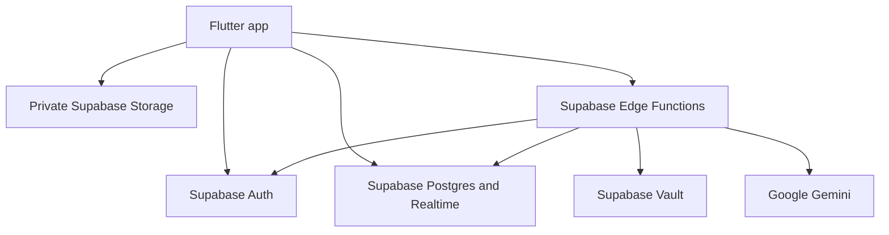

<p align="center">
  
</p>

<h1 align="center">Studexa</h1>

<p align="center"><strong>Intelligent classroom assessment and study-material platform</strong></p>

Studexa is a Flutter application for Teachers and Students. Teachers create classes, upload PDF/DOCX/PPTX material, generate grounded Actual and Practice quizzes with Gemini, edit questions, publish practice work, and monitor results. Students join with a class code, read materials, complete up to two attempts, and review their scores.

## Architecture



- **Authentication:** Supabase email/password and native Google sign-in
- **Database:** Supabase Postgres protected by RLS, with Realtime streams
- **Files:** private `study-materials` bucket with user/class policies
- **Backend:** `generate-quiz`, `teacher-gemini-key`, and `submit-quiz-attempt` Edge Functions
- **AI credentials:** each Teacher may store a personal Gemini key in Vault; the shared server secret is a limited backup
- **Extraction:** PDF, DOCX, and PPTX text extraction remains on device

The active application has no Firebase runtime dependency. Historical implementation notes may still describe the pre-migration backend.

## Local setup

1. Install Flutter and fetch dependencies:

   ```powershell
   flutter pub get
   ```

2. Copy `supabase.config.example.json` to the ignored `supabase.config.json` and set the project URL, publishable key, and Google Web OAuth client ID. These values identify public clients; never place the Supabase secret/service-role key or Gemini keys in this file.

3. Configure the Supabase project before testing sign-in:

   - Enable Google Auth with the same Web OAuth client ID and its secret.
   - Add the Android package `com.example.studexa` and the release signing fingerprints to the Google OAuth configuration.
   - Set the redirect URL `com.example.studexa://login-callback/`.
   - Configure a custom SMTP provider and email-confirmation redirect.
   - Keep the `study-materials` bucket private.
   - Set the Edge Function secret `GEMINI_API_KEY`.

4. Apply migrations and deploy functions:

   ```powershell
   npx supabase db push --linked
   npx supabase functions deploy generate-quiz
   npx supabase functions deploy teacher-gemini-key
   npx supabase functions deploy submit-quiz-attempt
   ```

5. Run the app:

   ```powershell
   flutter run --dart-define-from-file=supabase.config.json
   ```

6. Build the release APK:

   ```powershell
   flutter build apk --release --dart-define-from-file=supabase.config.json
   ```

The APK is written to `build/app/outputs/flutter-apk/app-release.apk`.

## Verification

```powershell
flutter analyze
flutter test
node --test supabase/functions/test/*.test.mjs
flutter build apk --release --dart-define-from-file=supabase.config.json
```

Database and RLS checks require a local Supabase stack:

```powershell
npx supabase start
npx supabase db reset
npx supabase test db
```

## Documentation

- [Project understanding](docs/PROJECT_UNDERSTANDING.md)
- [UI design walkthrough](docs/UI_DESIGN_WALKTHROUGH.md)
- [Network transactions](docs/NETWORK_TRANSACTIONS.md)
- [Implementation log](docs/IMPLEMENTATION_LOG.md)

The versioned schema lives in `supabase/migrations/`. Treat the migrations, RLS policies, and Edge Function authorization checks as one security boundary.
